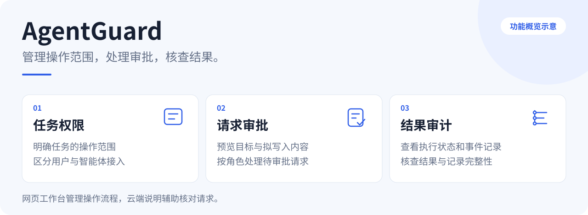
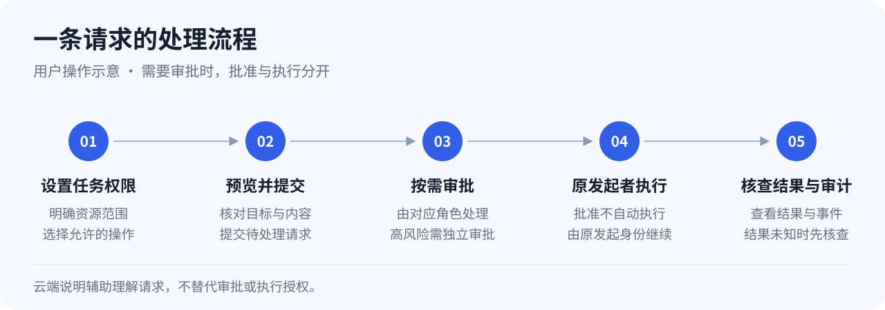

# AgentGuard

AgentGuard 是面向 AI 智能体工具操作的权限与审批工作台。它将任务范围、操作请求、人员审批和执行记录集中管理，便于用户了解智能体准备做什么、哪些请求需要处理，以及操作后的实际结果。

## 主要功能

| 功能 | 可以做什么 |
| --- | --- |
| **任务权限** | 为每项任务设置允许操作的资源与范围，区分用户和智能体接入身份。 |
| **请求工作台** | 集中查看待处理请求、当前状态和最近操作，减少来回查找。 |
| **操作预览** | 提交和审批前核对操作目标及拟写入内容，了解本次请求的具体影响。 |
| **人员审批** | 按角色处理需要确认的请求，高风险操作由独立审批者处理。 |
| **结果与审计** | 查看执行完成、阻断或结果未知等状态，结合事件记录核查操作过程。 |
| **云端说明** | 通过华为云 AgentArts 辅助核对和解释请求，帮助理解操作内容。 |

## 操作流程

先设置任务权限，再预览并提交请求。需要审批时，由对应人员处理；批准后，原发起身份另行继续执行。最后核对执行结果与审计记录。结果未知时，先核查实际状态，再决定后续处理。

**批准与执行是两个独立步骤，聊天中的同意或云端解释不构成执行授权。**

## 适用场景

- **项目文件维护**：限定本次任务的操作范围，提前查看拟写入内容，按要求完成审批与执行。
- **多人复核**：将任务所有者、独立审批者和操作发起者的职责区分开，集中处理待审批请求。
- **操作追溯**：当结果与预期不一致时，结合请求状态和事件记录核查经过。

## 网站与云端

网页工作台提供任务、请求、审批、结果和审计入口。华为云 AgentArts 用于请求核对与只读说明，辅助用户理解请求，不替代人员审批和执行授权。

以上两张插图均为**公开功能与用户流程示意**，不是实际运行截图或内部系统架构。

## 项目状态

当前为竞赛开发原型，已有本地功能及部分云端集成验证；这些验证不代表通用安全保证或生产认证。公开体验入口将在完成线上验收后补充。

比赛结束前，本仓库仅展示项目介绍和经检查的功能示意图。核心源码、实现细节、部署配置、实验数据和完整比赛材料暂不公开。详见 [公开范围说明](DISCLOSURE.md)。
